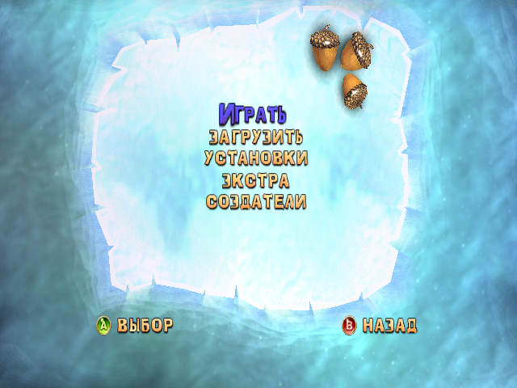
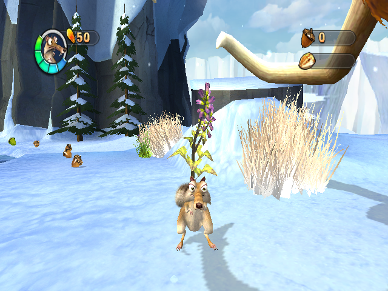

# Ice Age 2: The Meltdown — native Switch & Linux port

**Ice Age 2: The Meltdown** (original Xbox, NTSC-U), statically recompiled:
the game's x86 code is translated to C and compiled for the Switch's ARM CPU.
No emulator — the GPU, sound chip and kernel the game expects are provided by
a small runtime instead.

Built on the [xboxrecomp](https://github.com/sp00nznet/xboxrecomp) runtime as
vendored in [burnout3-sw](https://github.com/antoxa2584x/burnout3-sw); see
[what this port changed](docs/XBOXRECOMP_CHANGES.md).

**Version 0.2.2** · Switch (Vulkan / NVK) · Linux (OpenGL) · by **Meluxz**

| Main menu | First level |
|---|---|
|  |  |

> [!IMPORTANT]
> Nothing from the game is in this repository: no data, no generated code.
> You need your own Xbox disc, and the C code is generated from your own
> `default.xbe` — **[step-by-step guide](docs/BUILDING.md)**.

## What works

- The whole game runs from recompiled code: menus, movies, levels, saves
- 30 fps on Switch, as on the Xbox
- Audio (emulated MCPX APU), Joy-Cons / Pro Controller, keyboard or pad on Linux

## What this port adds

The runtime came from other Xbox ports; getting Ice Age 2 right meant finding
and fixing bugs in it, most of them in how single x86 instructions were
translated:

- **Scrat froze** on ice and ledges → x87 `lahf` was never translated, so 59
  float equality tests read garbage
- **Underwater streaks** → 8-bit `imul` was translated as 32-bit and wiped the
  row index of the ripple grid
- **Black acorns** in the menu → W-buffered depth was ignored
- **Blue snow, black horizon** → packed 565 clears, texture border colour
- **Crackling audio** → the music streamer now gets the CPU lock first
- **20 → 30 fps on Switch** → profiled on the console: CPU culling and lock
  handovers removed from the hot path

Details: [docs/XBOXRECOMP_CHANGES.md](docs/XBOXRECOMP_CHANGES.md) ·
history: [CHANGELOG.md](CHANGELOG.md)

## Installing on Switch

From a [release](https://github.com/Meluxz/iceage2-sw/releases) or your own build:

1. `iceage2.nro` → `sdmc:/switch/iceage2/`
2. Your extracted disc (`default.xbe`, `IceAge2/`, ...) → `sdmc:/switch/iceage2/game/`
3. Launch with **title takeover** (hold **R** on any game) — applet mode has
   too little memory

Log: `sdmc:/switch/iceage2/iceage2_log.txt` · options:
`sdmc:/switch/iceage2/iceage2_env.txt` (`KEY=VALUE` per line).

## Building

Linux or WSL2. The full walkthrough is in **[docs/BUILDING.md](docs/BUILDING.md)**.

<details open>
<summary><b>0. Extract your disc</b></summary>

```bash
# Writes game/ (default.xbe, IceAge2/, ...) -- git ignores it
python3 tools/xiso.py /path/to/IceAge2.iso extract game
```

</details>

<details open>
<summary><b>1. Lift the XBE to C</b></summary>

```bash
# Needs Python 3 with capstone (pip install capstone). Writes src/recomp/gen (~70 MB, ~25 min)
XBE=/path/to/game/default.xbe PYTHON=python3 tools/regen.sh
```

</details>

<details open>
<summary><b>2a. Linux</b> (SDL2 + OpenGL)</summary>

```bash
tools/build_linux.sh                                   # build/linux/iceage2_recomp
ICEAGE2_GAME_DIR=/path/to/game tools/play.sh
```

</details>

<details open>
<summary><b>2b. Nintendo Switch</b> (devkitA64, libnx, NVK from mesa-switch, glslang)</summary>

```bash
tools/build_switch_deps.sh                             # SDL2 + glslang for the Switch, into build/deps
# Vulkan build (needs mesa-switch NVK); optional hbmenu icon: assets/icon.jpg (256x256)
NVK_SDK=/path/to/nvk JOBS=2 tools/build_switch.sh      # out/switch/iceage2/iceage2.nro
```

</details>

## Repository

```
src/          boot, Switch layer, hand-written fixes for this game
xboxrecomp/   recompiler + runtime (kernel, NV2A GPU, MCPX audio, input)
config/       extra function entry points for the recompiler
tools/        disc extraction, code generation, build scripts
docs/         build guide, changes to xboxrecomp, screenshots
```

## Credits

[xboxrecomp](https://github.com/sp00nznet/xboxrecomp) (MIT) ·
[burnout3-sw](https://github.com/antoxa2584x/burnout3-sw) (MIT) ·
[xemu](https://xemu.app) (NV2A/APU reference, LGPL-2.1 audio parts) ·
[mesa-switch](https://github.com/danfromtico/mesa-switch) (NVK) ·
glslang · SDL2 · devkitPro / libnx

## License

MIT — see [LICENSE](LICENSE). `xboxrecomp/` keeps its own licence and
notices (`xboxrecomp/LICENSE`, `xboxrecomp/NOTICE`). Ice Age 2 is © its
respective owners.
