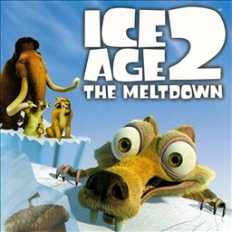

### Xbox static recompilation for Nintendo Switch and Linux

The original Xbox (NTSC-U) release of **Ice Age 2: The Meltdown**, lifted
instruction by instruction to C and running natively, with no emulator.

---

> [!IMPORTANT]
> **No game data is included**, and none of the code generated from it.
> You need your own copy of the Xbox disc, extracted (`default.xbe`,
> `IceAge2/`, ...), and you generate the C code from your own `default.xbe`.

## ✨ Features

- 🦫 **Native code**: the whole game runs as recompiled C (~11,000 functions),
  built with [xboxrecomp](https://github.com/sp00nznet/xboxrecomp)
- 🎮 **Two renderers**: Vulkan (NVK on Switch) and OpenGL (Linux), translating
  the NV2A pushbuffer, vertex programs and register combiners at run time
- 🔊 **Audio** through an emulated Xbox APU, out through SDL2
- 🎬 **Movies** (XMV) play
- 🕹️ Joy-Cons / Pro Controller (libnx), keyboard on Linux
- ⏱️ **30 fps**, as on the Xbox

## 🕹️ Playing on Switch

1. Copy `iceage2.nro` to `sdmc:/switch/iceage2/`.
2. Copy the **extracted** disc (not the ISO) to `sdmc:/switch/iceage2/game/`.
3. Start it with **title takeover**: hold **R** while launching any game.
   Applet mode leaves too little memory.

The log is written to `sdmc:/switch/iceage2/iceage2_log.txt`; settings go in
`sdmc:/switch/iceage2/iceage2_env.txt` (`KEY=VALUE` per line).

## 🛠️ Building

Everything builds on Linux (or WSL). Paths in `tools/` assume the developer's
layout and will need adjusting.

1. **Generate the C code** from your `default.xbe` (Python 3 with capstone):
   `tools/regen.sh` → `src/recomp/gen/` (git-ignored).
2. **Linux build** (GCC, SDL2, OpenGL/epoxy): `tools/wsl_build_pc.sh`
3. **Switch build** (devkitA64 + libnx, switch-sdl2, glslang, mesa-switch NVK):
   `tools/wsl_build_switch_deps.sh`, then `tools/wsl_build_switch.sh`

## 📁 Layout

| Path | What |
|---|---|
| `src/` | Boot, Switch layer, hand-written fixes (`recomp_manual.c`) |
| `xboxrecomp/` | The recompilation toolkit and runtime (kernel, NV2A, APU, input) |
| `config/` | Extra function entry points for the translator |
| `tools/` | Generation, build, debug and profiling scripts |
| `assets/` | Icon |

## 📊 Status

- Menus, movies and the first levels are playable
- 30 fps in menus; levels at 30 fps with dips in heavy scenes on Switch
- Saves load and save (`game/UDATA`)

See [CHANGELOG.md](CHANGELOG.md).

## 🙏 Credits

- [xboxrecomp](https://github.com/sp00nznet/xboxrecomp): the static recompiler (MIT)
- [burnout3-sw](https://github.com/antoxa2584x/burnout3-sw): the Switch runtime this builds on (MIT)
- [xemu](https://xemu.app): NV2A / APU reference and parts of the audio code (LGPL-2.1)
- Mesa / NVK, glslang, SDL2, devkitPro / libnx

Port by **Meluxz**.

## 📜 License

MIT ([LICENSE](LICENSE)). `xboxrecomp/` keeps its own licence and notices
(MIT, with LGPL-2.1 parts from xemu: see `xboxrecomp/NOTICE`).
Ice Age 2 is © its respective owners; this project contains none of its data.
